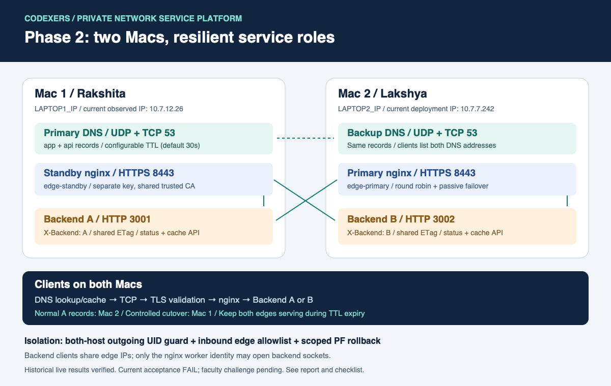

# Private Network Service Platform - Phase 1 and Phase 2

A two-Mac Computer Networks project by **Codexers**: **Rakshita** and
**Lakshya Choudhary**. DNS, TCP, TLS, HTTP, load balancing, caching, isolation
and recovery are the project; the backends intentionally remain simple.

**Submission status:** source and historical live evidence are organized for
review. The latest saved live acceptance (24 November, 16:56:37) is **FAIL** on
backup-DNS and primary-edge service paths. Earlier live successes are preserved.
The actual faculty-injected challenge (Extension F) and individual viva remain
pending. Publishing this repository does not certify current deployment health.
See [the submission checklist](SUBMISSION_CHECKLIST.md) for exact remaining gaps
and safe collection commands, and [the GitHub audit](GITHUB_AUDIT.md) for privacy
review and publication validation.

## Start the review here

- [Final report (PDF)](output/pdf/phase2-final-report.pdf) and [report source](docs/phase2/FINAL_REPORT.md)
- [Architecture and machine-role inventory](docs/phase2/ARCHITECTURE.md)
- [Configuration bundle](docs/phase2/CONFIGURATION_BUNDLE.md)
- [Actual test results](docs/phase2/TEST_RESULTS.md) and [genuine topic exports](evidence/phase2/exports/README.md)
- [Final demo: all 11 evaluation steps](docs/phase2/DEMO.md)
- [Troubleshooting and rollback](docs/phase2/TROUBLESHOOTING.md), [viva preparation](docs/phase2/VIVA.md)
- [Historical Phase 1 runbook](docs/PHASE1_RUNBOOK.md) and [historical evidence index](evidence/README.md)



| Machine | Documented deployment IP | Services |
|---|---|---|
| Rakshita / Mac 1 | 10.7.12.26 | primary DNS UDP/TCP 53, Backend A TCP 3001, standby nginx HTTPS 8443 |
| Lakshya / Mac 2 | 10.7.7.242 | backup DNS UDP/TCP 53, Backend B TCP 3002, primary nginx HTTPS 8443 |

Both edges route to both backends. Clients list both DNS servers. The domains
are `app.codexers.test` and `api.codexers.test`; normal DNS points to Mac 2.
HTTPS terminates at nginx with hostname/CA validation. HTTP 8080 redirects to
HTTPS 8443. LAN HTTP to remote backends is plaintext. Historical evidence keeps
its original addresses and timestamps; DHCP changes require reviewed config.
Mac 2's complete current inventory and reciprocal-client evidence are missing.

## What Phase 2 adds

A: second DNS resolver and client fallback; B: configurable TTL, record updates
and a real cache-expiry experiment; C: both-host PF UID guard with scoped
rollback; D: passive nginx backend failover and recovery; E: standby edge and
controlled DNS migration; F: layered diagnosis and repeatable fault procedures.
The actual faculty-injected fault has not been performed. DNS migration is
operator-controlled and does not remove the active edge as an automatic-failover
single point of failure.

## Fresh clone and safe local validation

```sh
git clone https://github.com/Rakshita-0023/cn-project.git
cd cn-project
make help
make test-local
```

Python 3.9+, nginx, dnsmasq, OpenSSL 3, curl, dig and lsof are required on macOS.
Install missing tools with `brew install nginx dnsmasq openssl python` as needed;
select Homebrew OpenSSL 3 in PATH. Optional Wireshark is used for packet review.
The local suite uses temporary processes and ephemeral loopback ports. It does
not stop deployed services, change client DNS/Keychain/PF, or fabricate LAN
results. Recorded deployment-audit suite: 38/38; current publication regressions
are recorded separately in GITHUB_AUDIT.md.

For actual deployment, follow [the two-Mac setup guide](phase2/README.md) and
[the per-Mac deployment runbook](docs/phase2/DEPLOYMENT_2026-11-24.md). Check each
Mac's current IP and network interface first. Create `network.env` locally with
`init --role 1 --peer-ip 10.7.7.242` or `init --role 2 --peer-ip 10.7.12.26`;
these are arguments to `python3 phase2/network.py`. Existing configuration is
never silently replaced. Use the real current addresses if DHCP changed them.
Private keys, runtime settings and previously deployed trust are not in Git.
The runbook covers separate edge keys, public CSR/certificate transfer, local
CA approval, trust, port conflicts and role-specific service startup.

A successful deployment can be inspected with the read-only collector:

```sh
bash scripts/collect_acceptance.sh
```

It records inventory, status and one actual complete acceptance run. A failed
run remains failed. `make diagnose` performs independent DNS/TCP/TLS/HTTP checks.
Fresh-clone key generation, trust installation, service start/stop, failure
injection, cache flush, DNS cutover and firewall operations require an authorized
setup/demo window; do not run them as passive audit checks.

## Evidence and privacy

The [clean 72-packet project capture](evidence/phase2/pcaps/dns-tcp-tls.pcapng)
contains the matching DNS pair at frames 16/17, TCP stream 0 handshake at
18/19/20, and TLS ClientHello/ServerHello at 21/24. The corrected DNS PNG is a
labelled genuine tshark export, not a simulated UI screenshot. TLS 1.3 encrypts
Certificate; historical Phase 1 TLS 1.2 screenshots are labelled separately.

The truncated pcap, unrelated background traffic, superseded image, raw private
material and local runtime state are excluded from the public tree. Four genuine
historical logs have only PF enable-reference values redacted; documentation and
provenance identify the transformation. Non-sensitive observations, dates,
failures and original source names are retained. `.gitignore` is a first guard;
tracked/staged files must still be audited before every publication.

## Deliverables and reproducibility

Backend source lives in `backend/`; Phase 1 DNS/nginx/TLS launchers remain in
their original directories. Phase 2 orchestration is in `phase2/`, with portable
source templates and review-only current-address specimens in the configuration
bundle. Source/private runtime are deliberately separated.

`python3 phase2/build_report.py` regenerates the report and test index using
ReportLab (optional document-export dependency). `make submission` prepares a
new dated review directory and clean ZIP; it does not deploy anything. Generated
ZIPs/staging directories are excluded from Git; the final PDF is a deliverable.
The public repository includes the source, report, relevant evidence, safe
configuration examples and evaluation instructions required for review.
