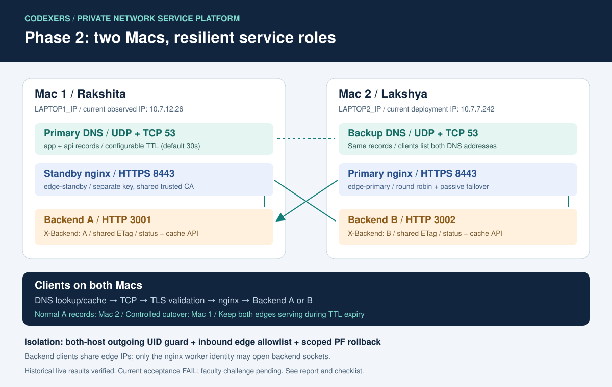
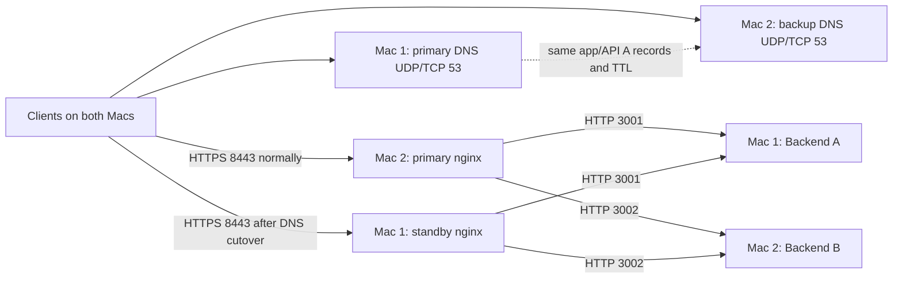

# Phase 2 architecture and inventory

Team: Codexers. Rakshita operates Mac 1; Lakshya operates Mac 2 (the existing
Phase 1 metadata spells his name Lakshya Choudhary). Two physical Macs combine
the four logical roles permitted by the assignment. Backends stay intentionally
simple; all additions concern the network.

| Machine | Current observation / configuration | Services | Owner |
|---|---|---|---|
| Mac 1 | Observed 24 Nov 2026: `10.7.12.26/19`, `en0`, gateway `10.7.0.1`; MAC in actual inventory | primary DNS :53, A :3001, standby HTTP :8080 / HTTPS :8443, client | Rakshita |
| Mac 2 | IP `10.7.7.242` corroborated by live traffic; interface/mask/gateway/MAC inventory still pending | backup DNS :53, B :3002, primary HTTP :8080 / HTTPS :8443, client | Lakshya |
| Historical Phase 1 | Mac 1 `10.7.18.118`; Mac 2 `10.7.31.46` | Historical only; preserved source evidence | Both |

The current Mac 1 observation is saved in
[`evidence/lan/inventory-laptop1.json`](../../evidence/lan/inventory-laptop1.json).
Run `make inventory` on each Mac immediately before evaluation. DHCP can change
these values. The `/19` subnet observed here includes the historical campus IPs,
but neither their continued allocation nor peer reachability is assumed.

| Setting | Mac/role mapping |
|---|---|
| `LAPTOP1_IP`, `DNS_IP`, `BACKEND_A_IP`, `STANDBY_EDGE_IP` | Mac 1's current LAN IPv4 |
| `LAPTOP2_IP`, `DNS_BACKUP_IP`, `BACKEND_B_IP`, `EDGE_IP` | Mac 2's current LAN IPv4 |
| app/API records, before migration | `EDGE_IP` |
| app/API records, after migration | `STANDBY_EDGE_IP` |
| `LAN_INTERFACE` | The actual interface on each local Mac |
| `EDGE_USER` | `_www` by default; only nginx should run under this worker identity |

Request flow is DNS lookup/cache -> TCP to the selected edge -> TLS hostname,
chain and time validation -> HTTPS request -> nginx-selected HTTP backend ->
response through TLS. DNS is a directory and does not carry the web request.
Client-to-edge TLS does not encrypt the LAN HTTP hop to a remote backend.
Capture both LAN and loopback because several hops are co-located.

## Isolation model and its limits

An inbound source-IP rule alone cannot distinguish an ordinary client on Mac 2
from nginx on Mac 2. This implementation adds outgoing UID rules on **both**
Macs. The root nginx master drops workers to the configured non-root account;
worker-created upstream sockets carry that effective UID. Only that UID can
open backend TCP connections. Incoming backend requests are restricted to the
two edge host addresses. Backends bind only their configured IPv4 LAN address.

Both hosts must enforce the outgoing guard. An unmanaged client on another IP
is denied by the inbound rule; a normal client on either managed host is denied
by the outgoing rule. Processes deliberately run under the worker account and
administrators who can change PF are outside this classroom trust boundary.
The default `_www` account may also be used by other web servers: keep it
exclusive during the demo or select a faculty-provided dedicated account.

PF syntax and live isolation from Rakshita's ordinary client were verified,
including after IP recovery at 16:21. Reciprocal peer-client enforcement remains
unrecorded. The final QA acceptance at 16:56 failed on DNS/edge service paths;
see FINAL_REPORT.md. Neither historical success nor syntax certifies current
end-to-end readiness. A `lo0` skip bypasses filtering;
the script refuses a detected skip. Existing backend states must be discarded
by restarting backends before fresh isolation checks. No global state flush is
performed. If live local-loopback isolation cannot be enforced on an institutional
Mac, report it as a limitation and request a faculty-approved account/template
or a separate client; do not claim an IP-only rule solved it.

The project uses the pre-existing `anchor "com.apple/*"` dispatcher, adds only
`com.apple/cn-phase2`, saves a rollback record before loading rules, acquires its
own PF enable-reference token and releases only that token. `/etc/pf.conf` and
unrelated anchors remain outside the project mutation scope. Read `man pf.conf`
(`user`, `set skip`, `quick`) and `man pfctl` (`-a`, `-E`, `-X`) on the actual Mac.

## Failure domains

Stopping Backend A leaves primary DNS and the standby edge alive; nginx retries
the request on B and temporarily quarantines A. The configured passive failure
window is five seconds by default; recovery occurs on a subsequent request,
not from an active background health checker. These semantics follow the
[nginx upstream documentation](https://nginx.org/en/docs/http/ngx_http_upstream_module.html).

Stopping primary DNS alone leaves A and both edges alive. A client may use a
cached answer or retry the backup; capture a real backup query after flushing
to distinguish those paths. Two listed DNS servers do not imply strict ordered
selection or zero failover delay.

The active edge remains a single point of failure until DNS is changed and old
answers expire. A standby process alone does not provide automatic edge HA.
Automatic elimination would need an independently monitored DNS/VIP failover
mechanism and appropriate LAN support. A whole Mac outage removes several
roles together. In particular, Mac 2 loss leaves backup DNS unavailable and
cached clients pointing to the old edge until manual cutover. Both laptops,
their shared Wi-Fi and power remain correlated failure domains.
